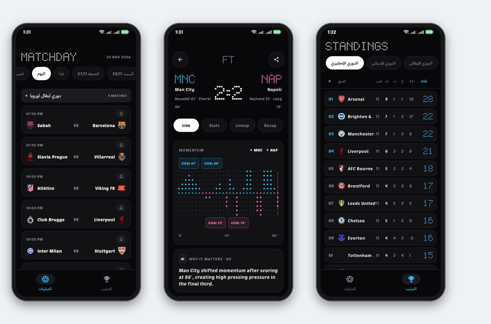

# CoraLive

CoraLive is an Android football app (Kotlin, Jetpack Compose). It shows live scores, league tables, match details, team and player profiles, and a simple match prediction. Data comes from ESPN's public soccer API. There is no backend and no login.

> Status: work in progress. The author has built and run it on a device; goal notifications and some screens are not finished (see "Known limits"). Not a store release.

## Screenshots

Left to right: Matches (Champions League day), Match details (Live tab with the momentum chart), Standings (Premier League). Screenshots taken on a phone, shown in a device frame. The bell buttons on the Matches screen are in the UI, but goal alerts are not active yet (see "Known limits"). The interface mixes Arabic and English labels.

## Leagues

Premier League, LaLiga, Serie A, Bundesliga, Ligue 1, Champions League (`core/model/League.kt`).

## Screens

- **Matches**: scores by league and date (bottom bar).
- **Standings**: league tables (bottom bar).
- **Match details**: tabs Live, Stats, Lineup, Recap. Live data refreshes every 10 seconds while the screen is open.
- **Team profile** and **Player profile**: opened from standings, match details and each other (routes in `AppNavHost`).
- **Prediction** (in the Recap tab): Dixon-Coles model using league standings.

| Package | Role |
|---|---|
| `MainActivity`, `CoraLive.kt` | Entry point; creates the notification channel, asks for notification permission, hosts the Compose UI |
| `navigation/` | `AppNavHost`: bottom bar (matches, standings) and routes `details`, `team_profile`, `player_profile` |
| `features/matches` | Live scores list |
| `features/match_details` | Match screen, tabs, repository, view model |
| `features/standings` | League tables |
| `features/profiles` | Team and player profiles |
| `features/analytics` | `DixonColesPredictor` and prediction model |
| `features/stats` | Top scorers and assists (code exists, not connected to navigation yet) |
| `core/network` | `EspnApiService` (Retrofit) and `NetworkModule` (OkHttp, JSON) |
| `core/model` | `League` |
| `core/details` | Shared match timeline and insights repository |
| `core/ui`, `ui/`, `ui/theme` | Shared components, dot-matrix charts, theme |
| `notification/` | Goal notification helper and score tracker (not wired yet) |

Most features have three subfolders: `presentation` (Compose screen + ViewModel), `data` (repository, calls `core/network`) and `domain` (models). `features/analytics` has only `domain` and `presentation`. `core/details` has `data` and `presentation`.

## Tech

Kotlin, Jetpack Compose (Material 3), Navigation Compose, Retrofit + OkHttp, kotlinx.serialization, Coil. minSdk 24, targetSdk 37, Java 11, core library desugaring for `java.time`. Exact versions are in `gradle/libs.versions.toml` and `app/build.gradle.kts`.

## Build

1. Open the project in Android Studio (a recent version that supports the Android Gradle Plugin in `libs.versions.toml`, with JDK 17).
2. Let Gradle sync, then run the `app` configuration on a device or emulator.

The release build type uses the debug signing key so it installs on your own phone. It is not a store-ready signing setup.

## Known limits

- Goal notifications are not active: `LiveScoreTracker.checkAndNotifyGoals` has no caller, and WorkManager is declared but unused.
- The `stats` feature is not reachable from the app navigation.
- The release build with code shrinking (R8) and API 24/25 devices were not tested.
- Data depends on an unofficial public ESPN endpoint that can change without notice.

## Credits and license

The prediction module was written with the Dixon-Coles approach of [pldashboard](https://github.com/tom-draper/pldashboard) as a reference (MIT). See `NOTICE.txt`. No license is chosen for CoraLive itself yet. Team logos and match data belong to their owners.
